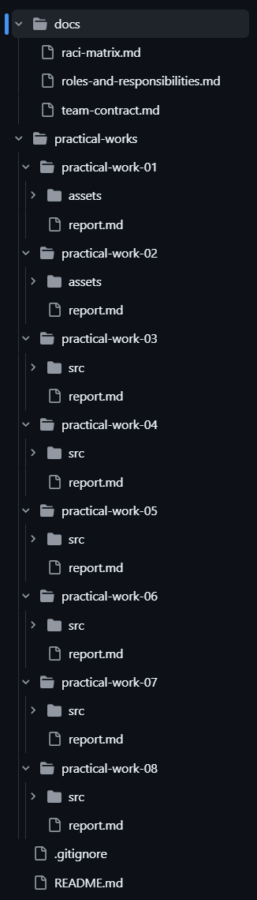
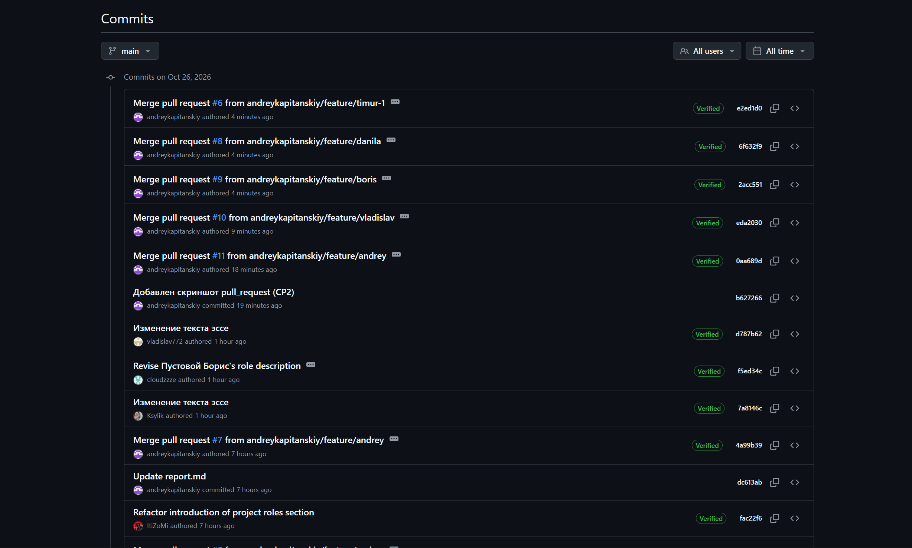
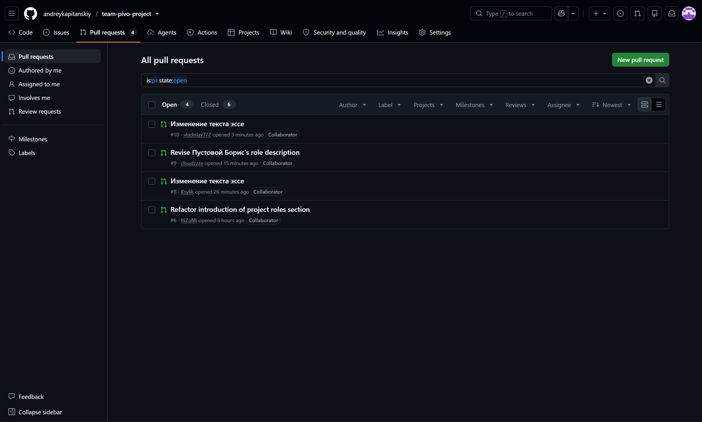

# Отчёт о выполнении самостоятельной работы №2

* **Дисциплина:** Введение в профессиональную деятельность
* **Команда:** «Пиво» (Группа 644, бригада №4)
* **Тема проекта:** «Создание сервиса подбора хобби»
* **Руководитель проекта:** Капитанский Андрей

---

## 1. Ссылка на командный репозиторий
[Командный репозиторий team-pivo-project](https://github.com/andreykapitanskiy/team-pivo-project)

---

## 2. Подтверждение регистрации участников на GitHub
* **Капитанский Андрей** (Руководитель проекта) — `@andreykapitanskiy`
* **Пустовой Борис** (Программист) — `@cloudzzze`
* **Загрудный Данила** (Тестировщик) — `@Ksylik`
* **Зокиров Тимур** (Архитектор ПО) — `@ItiZoMi`
* **Маскаев Владислав** (Специалист по данным) — `@vladislav772`

---

## 3. Структура репозитория

---

## 4. Распределение обязанностей по работе с репозиторием
В рамках данной работы функции управления версиями распределены на основе ролей из СР1:
* **Администрирование и инфраструктура (Капитанский Андрей — Руководитель проекта):** Создание общего репозитория, инициализация базовой структуры папок, настройка файлов `.gitignore` и `README.md`, управление слиянием веток (Pull Requests).
* **Документирование и разработка (Все участники):** Каждый член команды несёт персональную ответственность (роль **R** в матрице RACI) за подготовку материалов своей роли и фиксацию результатов в соответствующих разделах репозитория.

---

## 5. История коммитов репозитория
Для фиксации изменений использовались осмысленные сообщения коммитов. Ниже представлен скриншот вкладки History из GitHub Desktop / сайта GitHub с указанием авторов изменений:

---

## 6. Создание Pull Request и процесс ревью
Слияние личных веток с основной веткой `main` производилось через процедуру Pull Request:

---

## 7. Вывод
Система контроля версий Git и платформа GitHub помогают эффективно организовать командную работу. Они исключают путаницу при одновременной работе над проектом благодаря изолированным веткам. История коммитов позволяет чётко зафиксировать персональный вклад каждого участника, а механизм Pull Request обеспечивает прозрачный контроль качества кода и документации перед их добавлением в основную версию проекта.
